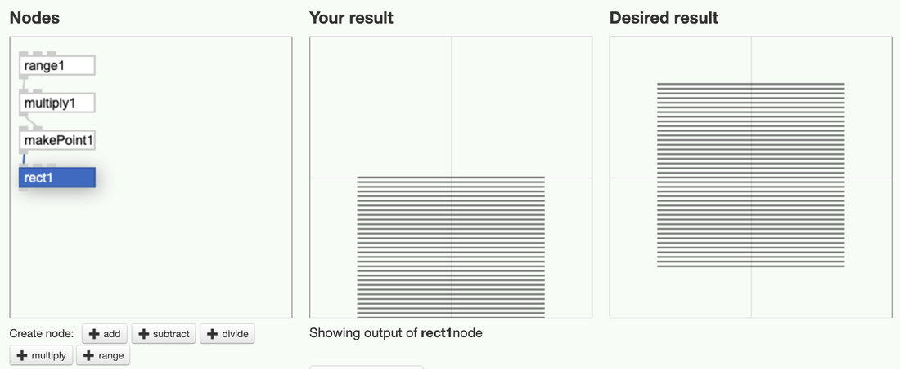
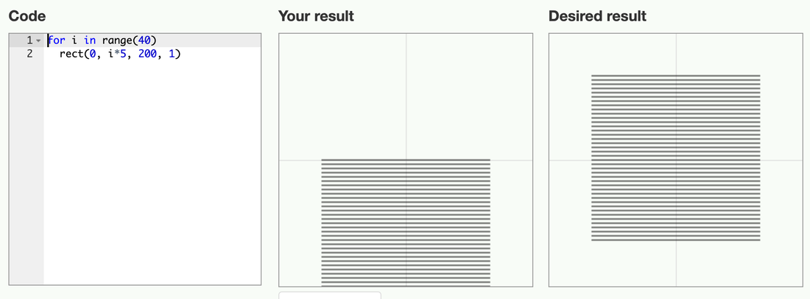
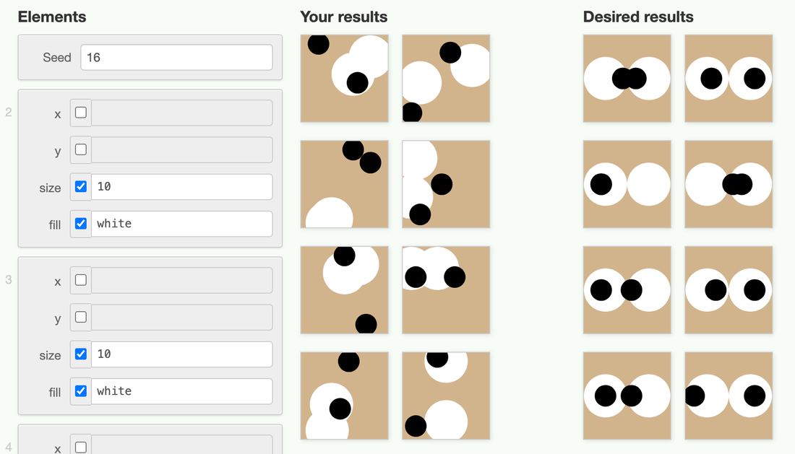

In 2013 we built Grasp, a website that tests whether designers understand a program better as code or as nodes. We expected nodes to win. Code was faster on almost every exercise, except for one, and that one told us something about why nodes help.

## The question

By early 2013 NodeBox 3 was out and we taught it in our workshops, next to NodeBox 1, where you write Python code. We had a strong feeling that designers got further with nodes, but we had never measured it. The studies that did measure it, by Thomas Green in the early 1990s, compared visual and textual programming languages with programmers and engineers, and they did not favor visual languages. Our question was whether graphic designers, who work visually all day, respond differently.

## How it worked

Grasp is a web application. I made the first version in February 2013 and kept working on it until the end of 2015. When you start a survey, Grasp asks about your experience with design software and with programming, then puts you in one of two groups at random. One group writes code, in a language that looks like Processing. The other group connects nodes, in an editor modelled on NodeBox 3, list matching included. You never see the other method. Both environments have the same look, the same canvas and the same coordinate system, so the only difference is code versus nodes.

Each exercise starts from a program that almost works. You see its result next to the result you need to reach:

Grasp compares your result with the desired result pixel by pixel. It never looks at your code or your network, so any solution that draws the right picture is correct. If you get stuck you can skip the exercise. Every edit is logged with a timestamp, so we know how long each exercise took and what people tried along the way.

Each exercise is a gate that only opens once you understand one concept, the way the puzzles in the game Portal work. These were the seven exercises:

1. **Align the squares**: the coordinate system.
2. **Color the left square**: in code, `fill("blue")` colors everything drawn after it, so you have to set the color back for the other square. This tests whether you understand that drawing has a state.
3. **Order the squares**: what is drawn last ends up on top.
4. **Move the squares**: 40 thin bars, drawn at `i * 5`, have to be centered by changing it to `i * 5 - 100`.
5. **Double the elements**: change the number of elements in a loop.
6. **A map of US prisoners**: size a dot for each state by its number of prisoners.
7. **A bar chart of temperatures**: the average monthly temperatures in New York, some of them below zero.

## The surveys

We first tried Grasp as an assignment at our workshop in Vilnius in March 2013. The surveys we analyzed come from our workshops in [Montréal](https://workshops.nodebox.net/2013-montreal/) (April 2013) and [Valence](https://workshops.nodebox.net/2013-valence/) (November 2013). We also used it with students at Sint Lucas Antwerp and the University of Antwerp. The participants were design students. They rated themselves as competent with design software, as novices in programming, and as having almost no experience with visual programming.

## What we found

Code was faster. On almost every exercise, the people writing code finished sooner than the people connecting nodes. Part of that is experience: our participants had at least seen some code before, and almost none of them had used nodes. Still, it was not the result we expected.

The exception was "move the squares". It asks for one subtraction. With code, only about one in five people solved it. With nodes, more than half did. The people writing code tried every arrangement of `i`, `5` and `100` they could think of, without finding the answer. In the node version, each operation is its own node: you take the range, multiply it, then subtract. The order of the operations is the order of the nodes, so there is nothing to guess. A formula in code has its own rules for the order of operations, and those rules are invisible.

We submitted a paper about Grasp to the GPCE conference in 2013, and it was rejected. The results ended up in section 4.7 of my PhD thesis, [The Impact of Generative Design](https://enigmeta.com/thesis/) (2016). My conclusion there was that, as programmers, graphic designers don't think differently from engineers, but that nodes make people more self-reliant with math, because every step is explicit. Grasp also turned out to be a good way to teach programming. Each exercise adds one concept, and the students who struggle and then get it remember it better than when they are told the answer.

## Rules

In 2015 I added a third mode to Grasp. Instead of writing code or connecting nodes, you make a list of shapes and decide which of their properties are fixed. Every property you leave open gets a random value, and Grasp draws eight variations at once. To solve an exercise, your variations have to match the desired ones:

We never ran a survey with the rules mode, but the idea continued in [Logic Layout](https://enigmeta.com/projects/2016-logic-layout/), a design application built on ranges and constraints.
