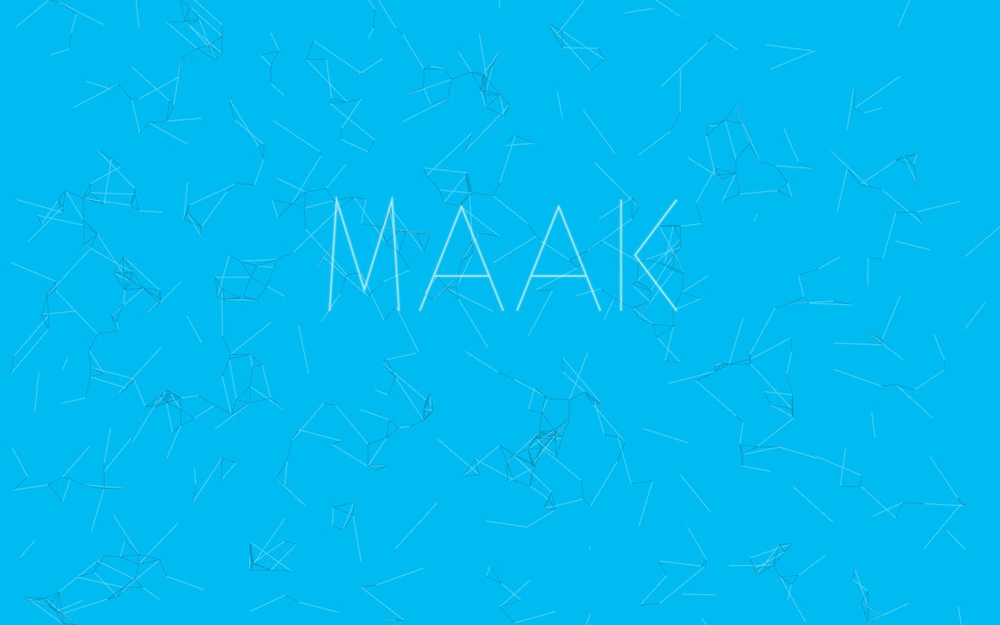
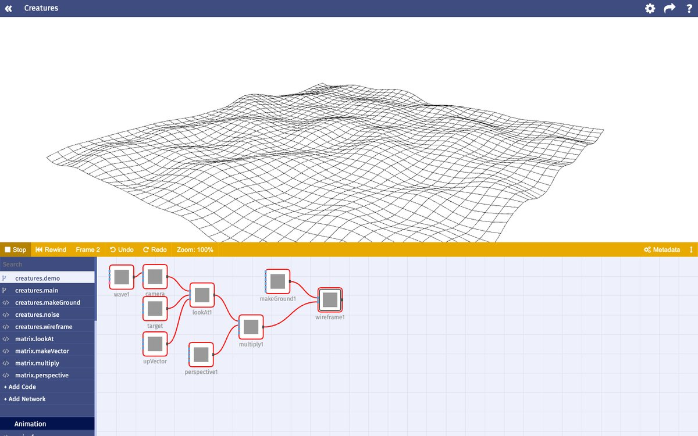
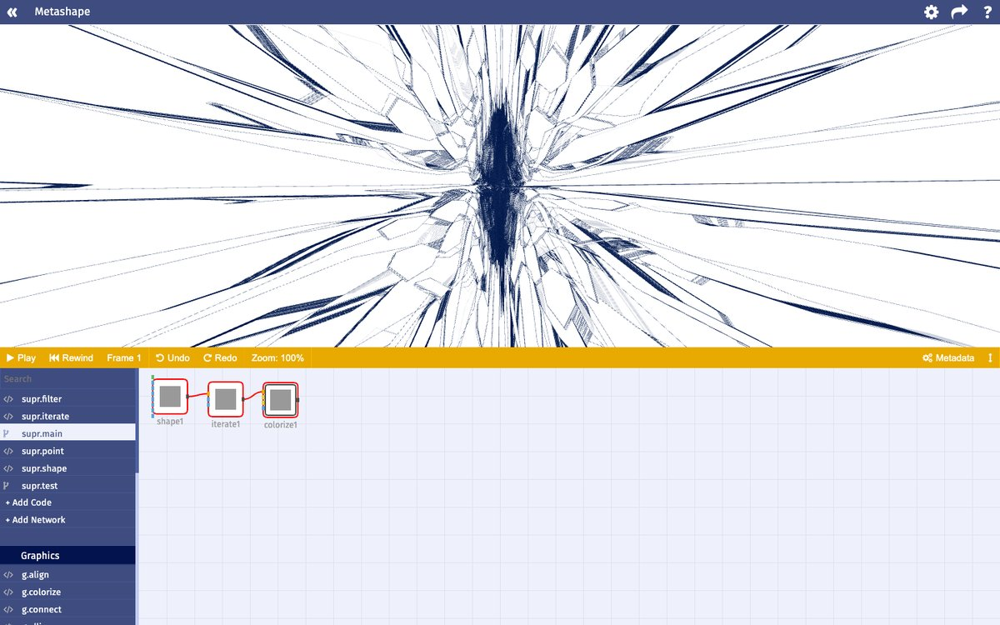
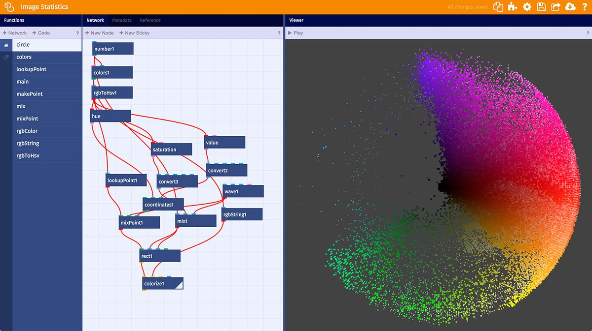

Between NodeBox 3 and NodeBox Live there was MAAK, a version of NodeBox that ran in the browser. We built it from September 2013 to September 2014. "Maak" is Dutch for "make". MAAK is where nodes and code became the same thing, and it turned into NodeBox Live.

<small>The launch page of maak.io, October 2013.</small>

## Why the browser

The request we heard most about NodeBox 3 was to put the work on the web. NodeBox 3 is a Java application, and there was no simple way to turn a NodeBox document into something that runs in a browser. We tried two ways in 2013. The first rendered NodeBox documents on a server (see [NodeBox On Demand](/blog/2026/11/03/nodebox-on-demand)), which worked for images but was too slow for animation. The second was an export option, where every node had two implementations, one in Java for the application and one in JavaScript for the web. Keeping two versions of every node in sync was tedious, and some nodes could not be ported as they were, because the desktop and the browser work too differently.

So in September 2013 we stopped porting nodes and started porting the whole application.

## Building it

The first commit is from 4 September 2013. Within two weeks, networks evaluated in the browser and list matching worked in JavaScript. Stefan Gabriëls ported the NodeBox 3 nodes to JavaScript. That graphics code later became its own library, [g.js](https://github.com/nodebox/g.js). Text was a problem: NodeBox 3 gets the outlines of letters from Java, and browsers had no way to do that. So I wrote [opentype.js](https://enigmeta.com/projects/2016-opentype-js/), which reads font files in JavaScript, the same month.

We called it NodeBox Cloud at first, and renamed it MAAK in October 2013, with a launch page at maak.io. We opened it to a small group of people early in 2014. Lieven Menschaert wrote the guide and the examples.

## Everything is a function

In NodeBox 3 a node is either built in, or a subnetwork you made yourself. In MAAK both are functions. A function is either a piece of JavaScript code or a network of nodes, and a network compiles to an ordinary JavaScript function, so code and networks can call each other in the same way. You could open the code behind every node, including the built-in ones, and change it. The list on the left of the screen shows them together: the code functions and the networks of a project, followed by the libraries it uses.

<small>A landscape for Creatures, drawn in 3D wireframe by a small matrix library written as MAAK functions.</small>

Because functions are shared, a change to one is picked up everywhere it is used. In NodeBox 3 a subnetwork is copied, and you have to keep the copies in sync yourself. A project could also use functions from other projects. Every project used the graphics functions from the `core` library this way.

The demo account had a dozen projects that tested what MAAK could do: a flock of boids, the Game of Life, [Word Maze](https://enigmeta.com/projects/2011-word-maze/), a chart of shipwrecks from a CSV file, and [Metashape](https://enigmeta.com/projects/2013-metashape/), a recursive superformula that we showed at the Incubate festival in Tilburg in 2013:

The boids and the Game of Life need to remember the previous frame. In MAAK, as in NodeBox 3, a node can be stateful: it receives its own result from the previous frame as an input.

## NodeBox Live

In the spring of 2014 we tried MAAK with students and rebuilt the interface based on their feedback, moving it from Angular to React. On 29 September 2014 we renamed MAAK to NodeBox Live, and a week later we gave the first lesson with it to students at Sint Lucas Antwerp.

<small>NodeBox Live after the move to React: the colors of a photo plotted by hue and saturation.</small>

NodeBox Live added things MAAK didn't have, such as the master list, which I described in [Where list matching came from](/blog/2026/11/03/where-list-matching-came-from), and undo. It stayed invite-only for years, with a new invite code for each school year, and we used it in workshops such as [Warsaw 2018](/blog/2018/06/01/workshop-warsaw). NodeBox Live still runs at [nodebox.live](https://nodebox.live/). My [project page](https://enigmeta.com/projects/2014-nodebox-live/) has more examples of what students made with it.
