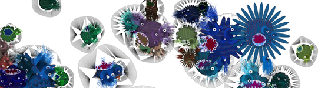
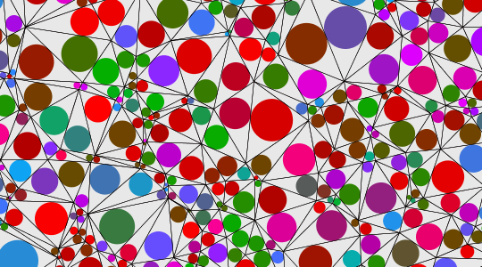
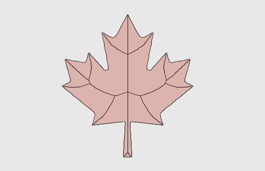
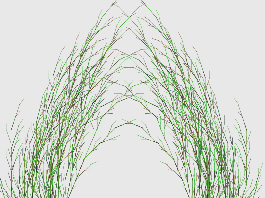
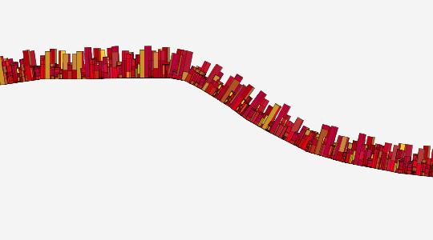
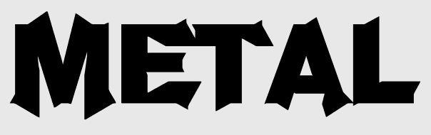
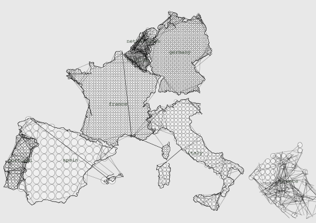
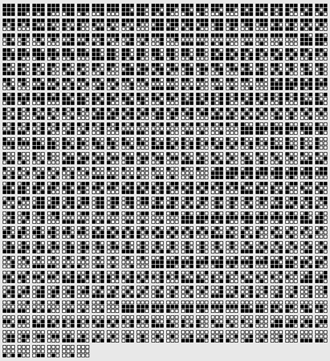

NodeBox 2 had its own website with a blog, from 2010 to 2011. Most of the posts were written by Lieven Menschaert, who built example networks to answer questions from the forum and from our workshops. The site has been offline for years, but its database was in an old server backup. These are the examples that still look good. You can read why we replaced NodeBox 2 in [What happened to NodeBox 2](/blog/2026/11/03/what-happened-to-nodebox-2).

Almost every example uses copy stamping, the NodeBox 2 way to make each copy of a shape different.

## Supershape creatures



Lieven rebuilt the "Aquatics" from the NodeBox 1 gallery (August 2010). Each creature is two supershapes on top of each other, made by a Python node that calls the NodeBox 1 supershape library. The first forms the head and gets a skin from a noise node; the second forms the mouth, with teeth from a spike node. Hair is drawn with curves where the eyes overlap the head. Copy stamping varies the color, the number of eyes, the size, the supershape parameters and the position of the mouth.

## Circle packing



This started as a forum question about circle packing (October 2010). One node creates Delaunay triangles; a second node, a Python port of Mark Meyer's NodeBox 1 code, computes the circle that fits inside each triangle and scales a shape into it. That shape can be anything, and with copy stamping each copy can be different. The header of the original post packed the supershape creatures instead of circles.

## Medial axis



The medial axis is a simple skeleton of a shape (November 2010). Lieven computed the Voronoi segments of the shape's points and kept the segments that fall inside the shape. It also works on shapes made of several paths, such as the SVG drawings of animals he tried it on.

## L-systems



An L-system node grows branches from a set of rewriting rules (December 2010). In this example it grows a hedge, and you can send any shape into it to draw at the ends of the branches. With copy stamping each of those shapes can be different.

## A city on a path



A "building" node splits a rectangle into smaller parts, with a choice of split functions and a level from 1 to 5 (October 2010). A shape on path node places the buildings along a path drawn with the freehand node, and copy stamping makes every building different. The same network also places buildings along the outline of text or an SVG drawing.

## Morphing between fonts



I wrote this one (March 2010) because people kept asking how to morph between two fonts. In theory it is one line of math:

```
glyph1 + ((glyph2 - glyph1) * factor)
```

With factors outside 0 to 1 you even get letters beyond the two fonts. In practice it only works on fonts that are very similar, because the same letter rarely has the same number of points in two fonts, even within one family. The fatpath node from NodeBox 1, converted to NodeBox 2, resamples both letters to the same number of points first. A sort node then shifts the start point of each contour, so the points of the two letters line up. The original post had five videos of the morphs, which are no longer online.

## A map from a CSV file



For a workshop on data visualization in Lahti, in 2010, Lieven and I made the data stamp node (May 2010). It works like copy stamping, but it makes one copy for every row in a CSV file and gives each copy the values of its row, through stamp keys such as `data_row_index` and `data_value_0`. In this example the rows are the number of website visitors per country. Each country, imported from SVG, becomes a grid of dots whose density depends on the number of visitors, and it is placed by its latitude and longitude.

## NodeBox 1 code inside NodeBox 2



From December 2010, the code node in NodeBox 2 could run NodeBox 1 drawing commands. The node draws on a NodeBox 1 canvas and returns everything on it as geometry, so you can send the result to other nodes. NodeBox 1 libraries work too, through `ximport`, except the ones that depend on Mac-only features such as Core Image. This image draws all 512 ways to fill a 3 by 3 grid.

## Animation

In May 2011 NodeBox 2 got expressions for animation. `wave()` oscillates between two values over time, with a sine, square, triangle or sawtooth shape. `timeloop()`, `hold()` and `schedule()` change values at given frames. Lieven's short videos of the [waves](https://www.youtube.com/watch?v=Vt9vFAIAxL4) and [timeloop](https://www.youtube.com/watch?v=OqdNZp0NdsE) examples are still on YouTube.
