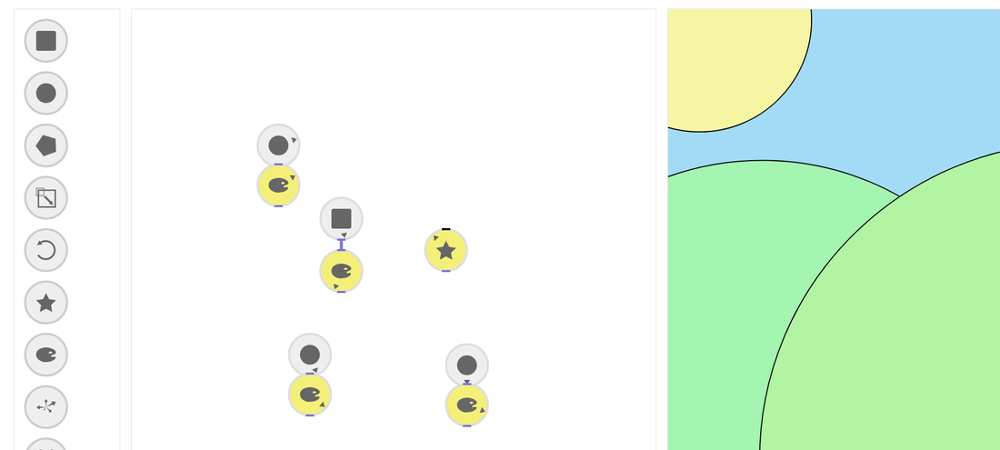

In the autumn of 2014 we talked about teaching NodeBox to children. The idea was a version without wires and without numbers, where you build a picture by putting blocks on a table. I made a browser prototype of it in November 2014, which we called NodeBox Jr.

<video controls preload="none" poster="/media/blog/nodebox-jr/nbjr-house.jpg" src="/media/blog/nodebox-jr/nbjr-house.mp4"></video>
<small>Building a landscape with hills, a sun and a house in NodeBox Jr, November 2014.</small>

## No wires, no numbers

NodeBox Jr has a shelf with nodes on the left, a network in the middle and the picture on the right. There are no connections to draw. A node connects to the nearest node above it, if it is close enough and the types fit. Put a colorize node under a circle and the circle gets a color; move it away and the color is gone.

Each node has one value, and you set it by rotating the node. Rotating a circle changes its size, rotating a colorize node changes its hue, and rotating a symbol node picks a different icon. Where a node sits in the network is where its shape appears in the picture. The nodes at the end of a chain turn yellow, and those are the ones that get drawn.

<small>The prototype running today: hills, a sun, a sky and a house, made from nine nodes.</small>

There were ten kinds of node: square, circle, polygon, scale, rotate, symbol, colorize, a supershape, and an emitter that sends copies of a shape flying out as particles.

## The table

The browser version was a step toward a physical one. The plan was a table with transparent blocks, each with a marker underneath, and a camera that tracks where the blocks are and how they are turned. Moving a block would move its node, and turning it would change its value. Lieven Menschaert and Lucas Nijs arranged a table and a camera for a test in November 2014.

When we first discussed the table, we noted that it would need an extra person. In January 2015 a demo movie of the table version was still on our list, and after that the project doesn't come up again. The browser prototype and two short screen recordings are what is left.
