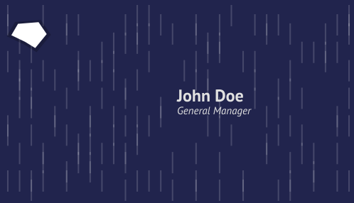

In 2013 we ran a web service that rendered NodeBox 3 documents from a URL. You put a document on the server, and anyone could ask for an image of it with different values for its nodes. We called it NodeBox On Demand.

## How it worked

Every document had its own address. Each query parameter of the render URL set a port of a node, written as `node.port`. This URL renders a business card with a name, a title and a variation number:

```
/demo/business-card/render?name.text=John%20Doe&title.text=General%20Manager&variation.value=7
```

The server loaded the document, filled in the values, rendered the network and sent back a PNG. Because the response was an ordinary image, any website could use the URL in an `` tag. The business card page asked for a new image every time you typed a letter.



Another demo document ran an icon through a snap node. Two sliders on its page set `snap1.position`, and each change requested a new image:


<small>The images in this post were rendered again with the current NodeBox, from the original documents.</small>

The server kept documents in memory and reloaded them when the file changed, so you could edit a document in NodeBox, save it, and the live service used the new version. It was written in Clojure, on top of the NodeBox 3 engine, between February 2013 and May 2014.

## The slogan generator

Its biggest use came from students. In the spring of 2013, a group of advertising students at Sint Lucas Antwerp made a website where visitors generated new slogans for the city of Antwerp. Every slogan on their site was rendered by NodeBox On Demand. On 29 May 2013 alone, the server rendered more than 50,000 of them.

## Why we moved on

On Demand worked well for images, but it couldn't do animation or interaction: every change meant another round trip to the server. People wanted their NodeBox work to run on the web, so we ported NodeBox itself to the browser. That became [MAAK](/blog/2026/11/03/maak-nodebox-in-the-browser), and later NodeBox Live.

NodeBox On Demand was the third NodeBox server. NodeBox 1 had one in 2006, which rendered Python scripts from a web form, and NodeBox 2 had one in 2010, which turned every port of a network into a slider in the browser.
