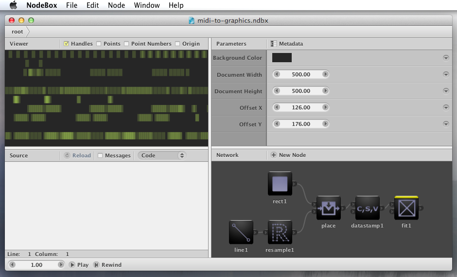
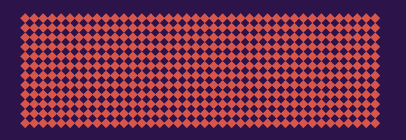
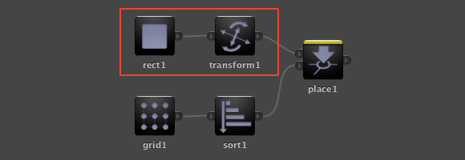
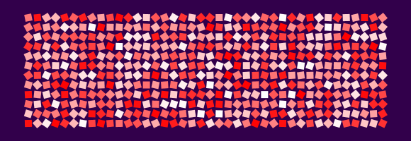

Between NodeBox 1, the Python app for Mac, and NodeBox 3, there was a NodeBox 2. If you started using NodeBox after 2012 you have probably never seen it. NodeBox 2 was our first node-based version, and we replaced it because its way of making variations was too hard for designers and too slow. We recently found its website, its documentation and every build we made in old server backups.


<small>NodeBox 2 in 2011, turning a MIDI file into graphics.</small>

## A node-based NodeBox

We started rewriting NodeBox in Java in August 2008. NodeBox 1 only ran on Mac and asked you to write Python code. We wanted an application that ran on Mac, Windows and Linux, where you build a design by connecting nodes. The first test builds came out in January 2009. Over the next three years we made 76 of them, from build 673 up to version 2.2 in September 2011. Version 2.0.963, in January 2010, was the first one we announced on the blog. Version 2.0.976 added undo in April 2011.

Inside, NodeBox 2 is a graph evaluator. Each node "cooks" its inputs into an output, and the application draws the output of the node you mark as rendered. I described that design in [NodeBox 2 is a Graph](https://enigmeta.com/posts/2011-05-01-nodebox-2-is-a-graph/).

## Copy stamping

A node in NodeBox 2 produced one shape. To get many shapes you used a copy or place node, which repeated its input. That gives you identical copies:



To make each copy different you turned on **copy stamping**. With copy stamping on, the place node goes back up the network and cooks its input nodes again for every copy, and those nodes can read the copy number through an expression. In this network, the nodes in the red box are cooked again for each copy:



To give each rectangle a different rotation, you typed this expression into the rotation field of the transform node:

```
stamp("CNUM", 45)
```

`CNUM` is the copy number, and 45 is the value to use when no copying is going on. A color took a nested expression, such as `hsb(stamp("CPOS", 0), 1, 1)`.



Expressions were everywhere in NodeBox 2. Any parameter could hold a Python expression instead of a value, and animation worked the same way, through functions such as `wave()` that read the current frame.

## What the workshops showed

We tested NodeBox 2 the way we test everything: in week-long workshops with design students, such as [Lahti 2010](https://workshops.nodebox.net/2010-lahti/), [Antwerp 2011](https://workshops.nodebox.net/2011-antwerp/) and [Helsinki 2011](https://workshops.nodebox.net/2011-helsinki/). Students could build simple networks quickly. As soon as they wanted variation, they needed copy stamping and expressions, and that is where most of them got stuck. In a copy-stamped design the variation lives in short pieces of text inside parameter fields, so you can't see it in the network. You have to remember which variables exist, which node provides them, and which default value to type.

It was also slow. Copy stamping cooks the upstream part of the network once per copy, so the grid above, with 12 rows and 40 columns, cooks the rectangle and the transform 480 times and evaluates the stamp expression 480 times.

## From expressions to lists

For NodeBox 3 we kept the nodes and removed copy stamping. Nodes now pass lists to each other. A grid node outputs a list of points. A node that receives a list runs once for every element. When two ports receive lists of different lengths, NodeBox matches them up. The rotated grid becomes a grid connected to a rectangle, with a list of angles connected to the rotation. The variation is a node in the network, where you can see it, and the engine doesn't have to go back up the graph to compute it. The next post, [Where list matching came from](/blog/2026/11/03/where-list-matching-came-from), explains that idea.

We called the first public build "NodeBox List Edition" and released it as an alpha in February 2012. The new engine landed in the main branch in May 2012, and the first NodeBox 3 releases followed in November 2012. In January 2013 we put this notice on the NodeBox 2 website:

> User feedback during testing in workshops showed that NodeBox 2's node model using expressions and copy stamping became complicated very quickly (not to mention slow). We decided to change our strategy and started working on NodeBox 3, which keeps the node-based approach but uses lists and list matching to make it easier to work with.

The NodeBox 2 source code is still in the [NodeBox repository](https://github.com/nodebox/nodebox/tree/v2.2), under the `v2.2` tag.
