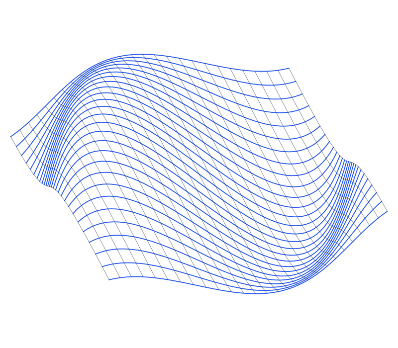

<section class="workshop-hero" aria-labelledby="hero-title">
  

    

      <h1 id="hero-title">Generative design with <em>nodes.</em></h1>
      
NodeBox is an open-source tool for generative graphics and data visualization. Connect operations, change their parameters, and export the result.

      
<a class="action-primary" href="/download/">Download ↓</a><a class="text-link" href="/node/documentation/">Documentation ↗</a>

    

    <figure class="hero-playground">
      

      <figcaption class="artwork-controls"><label for="bend">Bend</label><input id="bend" type="range" min="0" max="100" value="50" step="1" aria-valuetext="50 percent bend" disabled aria-describedby="bend-note"><output for="bend" id="bend-value">50%</output>Change the curvature of the surface. Use the arrow keys to adjust.<a href="/media/design/possibilities.ndbx" download>Download this example</a></figcaption>
    </figure>
  

</section>
<section class="idea-section section-shell" aria-labelledby="idea-title">
  
<h2 id="idea-title">How NodeBox works</h2>
Each node performs one operation. Connect them into a network to describe how a design is made. The network stays editable, so you can change the process as well as the result.

  

    
<h3>Data</h3>
Read a spreadsheet, generate a sequence of numbers, or arrange points on a grid.

    
<h3>Geometry</h3>
Draw paths, work with text, and combine, rotate or reshape what you have made.

    
<h3>Variation</h3>
Use repetition, randomness and changing values to produce variations from the same network.

  

</section>
<section class="software-section section-shell" aria-labelledby="software-title">
  

<h2 id="software-title">NodeBox 3</h2>
The desktop application for Mac, Windows and Linux. It includes a library of nodes for working with graphics, text and data.
<a class="action-primary" href="/download/">Download ↓</a><a class="text-link software-docs" href="/node/">More about NodeBox 3 ↗</a>
<figure class="software-figure"><figcaption><a href="/node/documentation/tutorial/getting-started.html">Getting started with NodeBox 3 ↗</a></figcaption></figure>

</section>
<section class="journal-section section-shell" aria-labelledby="journal-title">
  
<h2 id="journal-title">Blog</h2><a class="text-link" href="/blog/">All posts ↗</a>

  

  
    
  
  

</section>
<section class="community-section section-shell" aria-labelledby="community-title">
  

<h2 id="community-title">The NodeBox forum</h2>
Share your work, ask questions, and discuss NodeBox with other users and its developers.
<a class="text-link" href="https://forum.nodebox.net/">Visit the forum ↗</a>

</section>
<section class="newsletter-section section-shell" aria-labelledby="newsletter-title">
  
<h2 id="newsletter-title">Newsletter</h2>
Receive NodeBox news by email.

  <form action="https://nodebox.us7.list-manage.com/subscribe/post?u=18183e7289984568ad8565df3&amp;id=6b928876d6" method="post" target="_blank">
    <label class="sr-only" for="newsletter-email">Email address</label><input id="newsletter-email" type="email" name="EMAIL" autocomplete="email" placeholder="Your email address" required>
    
<label>Leave this field empty<input type="text" name="b_18183e7289984568ad8565df3_6b928876d6" tabindex="-1" value="" autocomplete="off"></label>

    <button type="submit">Subscribe ↗</button>
  </form>
</section>
