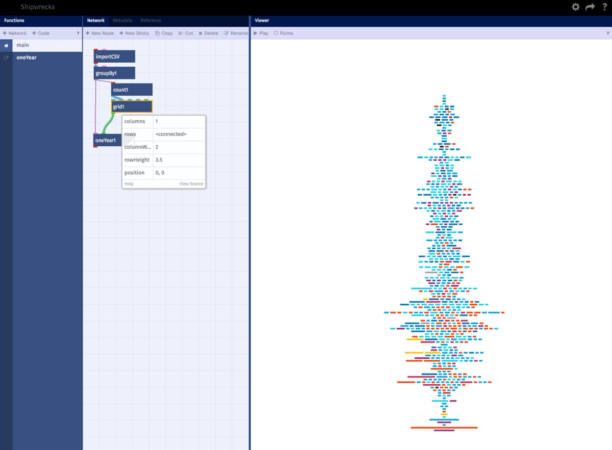

<section class="workshop-hero" aria-labelledby="hero-title">
  

    

      <h1 id="hero-title">Generative design with <em>nodes.</em></h1>
      
NodeBox is an open-source tool for generative graphics and data visualization. Connect operations, change their parameters, and export the result.

      
<a class="action-primary" href="/download/">Download ↓</a><a class="text-link" href="/node/documentation/">Documentation ↗</a><a class="text-link" href="https://nodebox.live/">NodeBox Live ↗</a>

    

    <figure class="hero-figure"></figure>
  

</section>
<section class="showcase section-shell" aria-label="Examples">
  
<button type="button" role="tab" id="tab-{{ ex.id }}" aria-controls="example-{{ ex.id }}" aria-selected="truefalse" tabindex="-1">{{ ex.category }}Nodes: {{ ex.nodes | join: ", " }}</button>

  


</section>
<section class="idea-section section-shell" aria-labelledby="idea-title">
  
<h2 id="idea-title">How NodeBox works</h2>
Each node performs one operation. Connect them into a network to describe how a design is made. The network stays editable, so you can change the process as well as the result.

  

    
<h3>Data</h3>
Read a spreadsheet, generate a sequence of numbers, or arrange points on a grid.

    
<h3>Geometry</h3>
Draw paths, work with text, and combine, rotate or reshape what you have made.

    
<h3>Variation</h3>
Use repetition, randomness and changing values to produce variations from the same network.

  

</section>
<section class="software-section section-shell" id="software" aria-labelledby="software-title">
  
<h2 id="software-title">NodeBox 3 and NodeBox Live</h2>
Both build designs from connected nodes. NodeBox 3 is an application you install. NodeBox Live runs in your browser, where your projects can be shared and embedded.

  

    <article class="edition">
      
      <h3 class="entry-title">NodeBox 3</h3>
      
The desktop application for Mac, Windows and Linux. It includes a library of nodes for working with graphics, text and data.

      
<a class="action-primary" href="/download/">Download ↓</a><a class="text-link" href="/node/">About NodeBox 3 ↗</a>

    </article>
    <article class="edition">
      
      <h3 class="entry-title">NodeBox Live</h3>
      
The web application. Work with CSV and JSON data or a web API, write your own nodes in JavaScript, and share projects with other people.

      
<a class="action-primary" href="https://nodebox.live/">Open NodeBox Live ↗</a><a class="text-link" href="/blog/2026/11/03/maak-nodebox-in-the-browser">How it began ↗</a>

    </article>
  

  

    <table class="compare">
      <thead><tr><td></td><th scope="col">NodeBox 3</th><th scope="col">NodeBox Live</th></tr></thead>
      <tbody>
        <tr><th scope="row">Runs</th><td>As an application on Mac, Windows and Linux.</td><td>In your browser. Nothing to install.</td></tr>
        <tr><th scope="row">Output</th><td>PDF files, image sequences and movies.</td><td>Interactive graphics that run on web pages.</td></tr>
        <tr><th scope="row">Your own nodes</th><td>Written in Java, Python or Clojure.</td><td>Written in JavaScript, in the editor.</td></tr>
        <tr><th scope="row">Sharing</th><td>Documents are .ndbx files that you send around.</td><td>Projects are shared online, and others can remix them.</td></tr>
        <tr><th scope="row">Getting started</th><td><a href="/download/">Download</a> and follow the <a href="/node/documentation/tutorial/getting-started.html">first tutorial</a>.</td><td><a href="https://nodebox.live/users/create">Sign up</a>. Help and examples are built into the editor.</td></tr>
      </tbody>
    </table>
  

</section>
<section class="works-section section-shell" aria-labelledby="works-title">
  <h2 id="works-title">Made with NodeBox</h2>
  

  
    <figure class="work">
      
      <figcaption><h3 class="entry-title">{{ work.title }}</h3>
{{ work.by }}. Made with {{ work.made }}.
</figcaption>
    </figure>
  
  

</section>
<section class="journal-section section-shell" aria-labelledby="journal-title">
  
<h2 id="journal-title">Blog</h2><a class="text-link" href="/blog/">All posts ↗</a>

  

  
    
  
  

</section>
<section class="community-section section-shell" aria-labelledby="community-title">
  

<h2 id="community-title">The NodeBox forum</h2>
Share your work, ask questions, and discuss NodeBox with other users and its developers.
<a class="text-link" href="https://forum.nodebox.net/">Visit the forum ↗</a>

</section>
<section class="newsletter-section section-shell" aria-labelledby="newsletter-title">
  
<h2 id="newsletter-title">Newsletter</h2>
Receive NodeBox news by email.

  <form action="https://nodebox.us7.list-manage.com/subscribe/post?u=18183e7289984568ad8565df3&amp;id=6b928876d6" method="post" target="_blank">
    <label class="sr-only" for="newsletter-email">Email address</label><input id="newsletter-email" type="email" name="EMAIL" autocomplete="email" placeholder="Your email address" required>
    
<label>Leave this field empty<input type="text" name="b_18183e7289984568ad8565df3_6b928876d6" tabindex="-1" value="" autocomplete="off"></label>

    <button type="submit">Subscribe ↗</button>
  </form>
</section>
